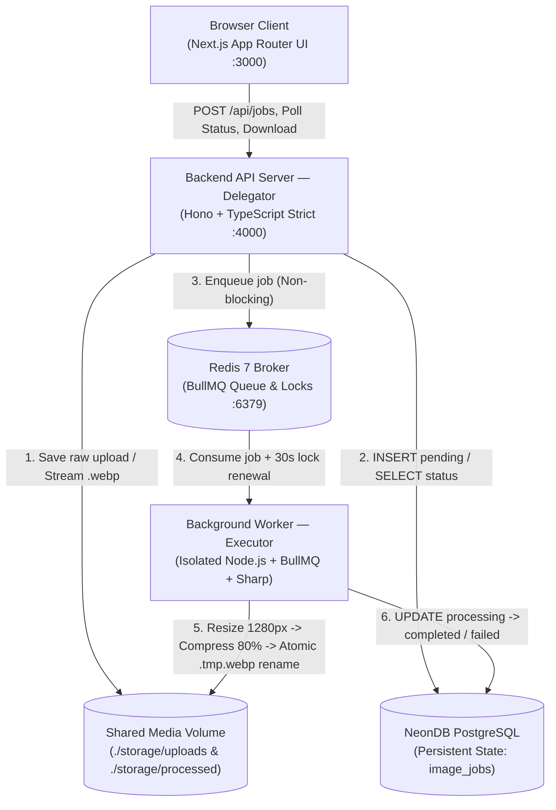

# CFactory Async Image Processor (CAIP)

An asynchronous image processing web application demonstrating production-grade **process separation between an HTTP API Delegator and an isolated Background Worker**. Users upload large images (`JPG`, `PNG`, or `WebP`, up to `20 MB`), receive an immediate `job_id` (`HTTP 202 Accepted`), track real-time lifecycle progress (`pending -> processing -> completed / failed`) via exponential backoff polling, compare the result visually, and download the optimized WebP output.

---

## Architecture Overview



### Core Features & Bonus Capabilities
- **Strict Process Isolation**: `backend-api` acts purely as a non-blocking HTTP delegator and has **zero dependency on `sharp`**. Image decoding, resizing, compression, and WebP transcoding run exclusively in the isolated `worker` process/container.
- **Ordered Sharp Image Pipeline**:
  1. Auto-orient EXIF & **Resize** to a maximum of `1280px` on the longest side while preserving aspect ratio (`fit: 'inside'`, `withoutEnlargement: true`).
  2. **Compress** to `80%` quality.
  3. **Convert** to **WebP** format.
- **Defense-in-Depth Input Validation**: Client-side pre-checks paired with server-side **binary magic-bytes inspection** (`JPEG`, `PNG`, `WebP` signatures), strict `0 < size <= 20 MB` limits, path-traversal protection, and PostgreSQL `CHECK` constraints.
- **Graceful Crash & Failure Recovery**:
  - **Atomic File Writes**: Worker writes to `{job_id}.tmp.webp` and promotes via atomic `fs.rename` to `{job_id}.webp` before updating PostgreSQL to `completed`.
  - **BullMQ Stalled Job Detection**: Configured with `lockDuration: 30000ms`, `stalledInterval: 15000ms`, and `maxStalledCount: 2`.
  - **Smart Error Classification**: Corrupted/unsupported image streams throw `UnrecoverableError` to fail fast without wasting retries, while transient I/O errors retry with exponential backoff (`3` attempts).
  - **Startup State Reconciliation**: On boot, the worker detects orphaned `processing` rows in PostgreSQL whose jobs are no longer active in Redis, cleans leftover `.tmp.webp` files, and marks them `failed`.
  - **Graceful Shutdown (`SIGTERM`/`SIGINT`)**: Calls `await worker.close()` (backed by Docker `stop_grace_period: 35s`) so active jobs finish cleanly before process exit.
- **Efficient Frontend Polling**: Custom `useJobPolling` hook using **Exponential Backoff with ±15% Jitter** (`500ms -> 875ms -> 1531ms -> 2680ms -> 4689ms -> 5000ms` cap), `AbortController` cancellation, and automatic stop upon reaching `completed` or `failed`.
- **Single-Command Docker Compose Stack**: Runs `redis`, `backend-api`, `worker`, and `frontend` with healthchecks and shared volume mounting.
- **TypeScript Strict Mode & Automated Testing**: `"strict": true` across all 3 workspaces plus 20 unit and integration tests powered by Vitest.

---

## Tech Stack

| Layer | Technology | Port |
|---|---|---|
| **Frontend** | Next.js 15 (App Router), React 19, TypeScript (`strict`), ArcUI (`@uiarc/*`), Lucide | `3000` |
| **Backend API** | Node.js 20+, TypeScript (`strict`), Hono (`@hono/node-server`), BullMQ, `pg`, Zod | `4000` |
| **Background Worker** | Node.js 20+, TypeScript (`strict`), BullMQ Worker, Sharp (`libvips`), `pg`, Zod | Headless |
| **Database** | NeonDB PostgreSQL (Serverless SSL PostgreSQL) | `5432` (TLS) |
| **Message Queue** | Redis 7 (Alpine with AOF persistence) | `6379` |
| **Testing** | Vitest (Unit & End-to-End API + Worker Integration) | — |

---

## Prerequisites

- **Docker Desktop / Docker Engine** with Docker Compose v2 (recommended for single-command startup)
- **Node.js >= 20 LTS** and **npm >= 10** (for local development & running tests)
- A **NeonDB PostgreSQL** database (or any PostgreSQL 14+ instance)

---

## Setup Instructions

### 1. Clone the Repository & Configure Environment Variables

```bash
git clone https://github.com/FadhilAlif/Technical-Test-CFactory.git
cd Technical-Test-CFactory
cp .env.example .env
```

Edit `.env` and set `DATABASE_URL` to your NeonDB PostgreSQL connection string (including `?sslmode=require`).

### 2. Initialize the Database Schema

Run [`Database/schema.sql`](Database/schema.sql) once against your NeonDB / PostgreSQL database (via Neon SQL Editor or `psql`):

```bash
psql "$DATABASE_URL" -f Database/schema.sql
```

This script is idempotent (`CREATE TABLE IF NOT EXISTS`) and creates the `image_jobs` table, validation `CHECK` constraints, status index, and `updated_at` trigger.

### 3. Run the Entire Stack with One Command (Docker Compose)

```bash
docker compose up --build
```

Once all containers pass their healthchecks:
- **Interactive Web UI**: `http://localhost:3000`
- **Backend API Healthcheck**: `http://localhost:4000/api/health`

To stop and remove containers:
```bash
docker compose down
```

### 4. Local Development Setup (Without Full Docker Build)

1. Install workspace dependencies:
   ```bash
   npm install
   ```
2. Start Redis (via Docker or a local Redis instance on port `6379`):
   ```bash
   docker compose up redis -d
   ```
3. Ensure `frontend/.env.local` has:
   ```env
   NEXT_PUBLIC_API_BASE_URL=http://localhost:4000
   NEXT_PUBLIC_MAX_FILE_SIZE_MB=20
   ```
4. Open **three separate terminals** at the repository root to demonstrate server vs. worker process isolation:
   ```bash
   # Terminal 1 — Backend API Delegator (Port 4000)
   npm run dev:api

   # Terminal 2 — Isolated Background Worker (BullMQ + Sharp)
   npm run dev:worker

   # Terminal 3 — Next.js Interactive Frontend (Port 3000)
   npm run dev:frontend
   ```

---

## Required Environment Variables

All configuration is loaded via environment variables (no hardcoded credentials in source code). See [`.env.example`](.env.example).

| Variable | Required | Default | Used By | Description |
|---|---|---|---|---|
| `DATABASE_URL` | **Yes** | — | `backend-api`, `worker` | PostgreSQL / NeonDB connection string (`?sslmode=require` for NeonDB) |
| `REDIS_URL` | No | `redis://localhost:6379` | `backend-api`, `worker` | Redis connection URL (`redis://redis:6379` inside Docker Compose) |
| `BULLMQ_QUEUE_NAME` | No | `image-processing-queue` | `backend-api`, `worker` | Shared BullMQ queue name |
| `STORAGE_DIR` | No | `./storage` (Docker: `/app/storage`) | `backend-api`, `worker` | Shared filesystem directory for `uploads/` and `processed/` |
| `MAX_FILE_SIZE_BYTES` | No | `20971520` (20 MB) | `backend-api` | Maximum allowed image upload size in bytes |
| `PORT` | No | `4000` | `backend-api` | HTTP listening port for Hono API server |
| `CORS_ORIGIN` | No | `http://localhost:3000` | `backend-api` | Allowed CORS origin(s), comma-separated |
| `WORKER_CONCURRENCY` | No | `2` | `worker` | Number of concurrent image jobs processed per worker instance |
| `STALE_JOB_THRESHOLD_MINUTES` | No | `2` | `worker` | Age threshold for startup reconciliation of orphaned `processing` rows |
| `NEXT_PUBLIC_API_BASE_URL` | No | `http://localhost:4000` | `frontend` | Public API base URL consumed by browser fetch requests |
| `NEXT_PUBLIC_MAX_FILE_SIZE_MB` | No | `20` | `frontend` | Client-side pre-validation max file size in MB |

---

## REST API Contract

| Method | Endpoint | Description | Success Status |
|---|---|---|---|
| `POST` | `/api/jobs` | Upload image (`multipart/form-data`, field `image`) & enqueue async job | `202 Accepted` |
| `GET` | `/api/jobs/:jobId` | Fetch current job status (`pending`, `processing`, `completed`, `failed`) & metadata | `200 OK` |
| `GET` | `/api/jobs/:jobId/download` | Stream processed `.webp` output (`?inline=1` for inline preview) | `200 OK` (`image/webp`) |
| `GET` | `/api/health` | Verify live connectivity to NeonDB PostgreSQL and Redis | `200 OK` / `503` |

### Quick cURL Verification

```bash
# 1. Upload an image (returns 202 Accepted immediately with job_id)
curl -i -X POST http://localhost:4000/api/jobs -F "image=@sample.jpg"

# 2. Poll job status
curl -s http://localhost:4000/api/jobs/<job_id>

# 3. Download processed WebP once status === "completed"
curl -L -o result.webp http://localhost:4000/api/jobs/<job_id>/download
```

---

## Testing & Type Safety

```bash
# Run all unit & integration tests (Vitest)
npm test

# Verify TypeScript strict mode (tsc --noEmit) across all 3 workspaces
npm run typecheck

# Build all workspaces for production
npm run build
```

Test coverage includes:
- `tests/unit/file-validator.test.ts` — Magic-bytes detection (JPEG/PNG/WebP), spoofed file rejection (`415`), 20 MB boundary (`413`), empty files (`400`), filename sanitization.
- `tests/unit/image-processor.test.ts` — Sharp pipeline for landscape > 1280px, portrait > 1280px, small images without upscaling, atomic `.tmp.webp` rename, corrupted file cleanup, and path-traversal rejection.
- `tests/unit/backoff.test.ts` — Exponential backoff progression (`500ms -> 5000ms` cap), jitter bounds, and client validators.
- `tests/integration/api-and-worker.test.ts` — End-to-end non-blocking `202 Accepted` upload -> `409` download guard while pending -> isolated worker processing -> `200 image/webp` binary verification -> corrupted job `failed` (`422`) -> startup reconciliation -> `/api/health`.

---

## Architectural Decisions & Trade-Offs

### 1. BullMQ (Redis) + NeonDB PostgreSQL vs. Pure Database Polling
- **Decision**: Use **BullMQ on Redis 7** for job queuing/scheduling and **NeonDB PostgreSQL** as the persistent source of truth for job state and metadata.
- **Rationale**: Pure database polling (`SELECT ... FOR UPDATE SKIP LOCKED` every second) creates continuous idle queries against serverless PostgreSQL and introduces polling latency. BullMQ provides low-latency event-driven delivery (`< 10ms`), built-in worker lock renewal, stalled-job recovery, and exponential retry backoff, while PostgreSQL keeps queryable metadata and enforces schema-level constraints.
- **Trade-off**: Introduces Redis as an additional infrastructure component, mitigated by single-command orchestration via `docker-compose.yml`.

### 2. Process-Isolated Hono API Server vs. Worker (`libvips` / Sharp)
- **Decision**: Split `backend-api` and `worker` into independent workspace packages and containers, forbidding `sharp` inside `backend-api`.
- **Rationale**: Decoding and re-encoding 20 MB images saturates CPU and libuv threads. Isolating the worker guarantees the HTTP event loop stays responsive (`202 Accepted` in milliseconds) and allows scaling workers horizontally (`docker compose up --scale worker=3`) independent of the API tier.
- **Trade-off**: Requires shared media storage between API and Worker. Accessing files through the `StorageService` abstraction keeps migration to object storage (S3 / Cloudflare R2) straightforward for multi-host production deployments.

### 3. Sharp (`libvips`) with `sharp.cache(false)` and Atomic Writes
- **Decision**: Use **Sharp** with `.rotate().resize({ fit: 'inside', withoutEnlargement: true }).webp({ quality: 80 })`, disable libvips file descriptor caching (`sharp.cache(false)`), and write to `.tmp.webp` before atomic `fs.rename`.
- **Rationale**: Sharp is 4–5× faster and far more memory-efficient than pure-JS encoders for 20 MB files. Disabling the cache prevents Windows file-handle locks (`EBUSY`) and lowers worker RSS memory for unique UUID uploads. Atomic rename guarantees the download endpoint never serves half-written corrupt WebP files if a worker crashes mid-write.
- **Trade-off**: Native `libvips` binaries are OS-specific, so `worker/Dockerfile` intentionally uses `node:20-bookworm-slim` (glibc) while `backend-api` and `frontend` remain on lightweight `node:20-alpine`.

### 4. Exponential Backoff with Jitter Polling vs. WebSockets
- **Decision**: Poll `GET /api/jobs/:jobId` with exponential backoff (`500ms -> 875ms -> 1531ms -> 2680ms -> 4689ms -> 5000ms` cap) plus `±15%` random jitter and `AbortController` cleanup.
- **Rationale**: Small images feel instantaneous on the first `500ms` check while larger jobs avoid hammering the API and NeonDB with fixed short-interval requests. Jitter avoids thundering-herd spikes across concurrent clients, and stateless HTTP polling scales cleanly without sticky WebSocket connections.
- **Trade-off**: Worst-case completion notification delay is bounded by the `5s` cap—acceptable for asynchronous file conversion workflows.

### 5. Hono & Dependency Injection App Factory
- **Decision**: Build the HTTP layer with **Hono** wrapped in `createApp(deps)` rather than binding global singletons at module import time.
- **Rationale**: Hono is lightweight, TypeScript-first, and built on Web Standards (`Request`/`Response`), enabling deterministic integration testing via `app.request()` without opening network ports.

---

## Project Structure

```text
Technical-Test-CFactory/
├── backend-api/            # Hono HTTP API Server — Delegator (Port 4000, no sharp)
├── worker/                 # Isolated BullMQ + Sharp Background Worker
├── frontend/               # Next.js App Router Interactive Web UI (Port 3000)
├── Database/
│   └── schema.sql          # Idempotent PostgreSQL DDL (image_jobs, checks, index, trigger)
├── tests/
│   ├── unit/               # File validator, Sharp pipeline & exponential backoff tests
│   └── integration/        # End-to-end API delegation + worker lifecycle tests
├── docs/                   # PRD, Architecture, Integration, User Stories, User Flow & Guide
├── storage/                # Local media mount (uploads/ and processed/)
├── docker-compose.yml      # Single-command full-stack orchestration
├── .env.example            # Environment variable reference template
└── README.md
```

---

## Additional Documentation

- [Product Requirements Document (`docs/PRD.md`)](docs/PRD.md)
- [System Architecture & ADRs (`docs/ARCHITECTURE.md`)](docs/ARCHITECTURE.md)
- [Integration Specification (`docs/INTEGRATION.md`)](docs/INTEGRATION.md)
- [User Stories & Traceability Matrix (`docs/USER_STORIES.md`)](docs/USER_STORIES.md)
- [User Flow & UI State Machine (`docs/USER_FLOW.md`)](docs/USER_FLOW.md)
- [User & End-to-End Testing Guide (`docs/USER_GUIDE.md`)](docs/USER_GUIDE.md)
