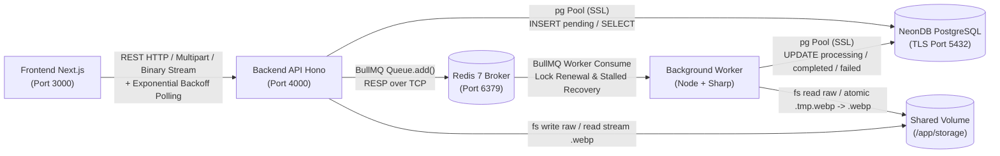

# SYSTEM INTEGRATION SPECIFICATION (INTEGRATION.md)

## CFactory Async Image Processor (CAIP)
### Kontrak Integrasi Lintas Layanan: REST API, Redis BullMQ, NeonDB PostgreSQL, Shared Storage & Docker

| Metadata Dokumen | Nilai |
|------------------|-------|
| **Versi** | 1.0 |
| **Tanggal Terbit** | 2026-11-21 |
| **Pola Integrasi** | Asynchronous Queue-Based Producer–Consumer + Shared Persistent State & Media Volume |
| **Stack Layanan** | Next.js 15/16 (`:3000`) <-> Hono API (`:4000`) <-> Redis 7 (`:6379`) & NeonDB PostgreSQL <-> Sharp Worker |
| **Status Dokumen** | Approved |

---

## 1. Arsitektur & Protokol Integrasi Lintas Komponen



### Matriks Protokol Komunikasi Antar Komponen
| Sumber | Tujuan | Protokol & Format Data | Tujuan Integrasi | Pola Ketahanan |
|---|---|---|---|---|
| `frontend` | `backend-api` | HTTP/1.1 (`multipart/form-data`, JSON, Binary `image/webp`) | Upload gambar, polling status, unduh hasil WebP | `AbortController`, exponential backoff + jitter |
| `backend-api` | `Redis 7` | TCP RESP via `ioredis` / `BullMQ` | Enqueue job `process-image` secara non-blocking | `maxRetriesPerRequest: null`, reconnect backoff |
| `backend-api` | `NeonDB PG` | PostgreSQL Wire over TLS (`sslmode=require`) via `pg.Pool` | Simpan record `pending`, query status & path unduhan | Pool max 10 koneksi, parameterized SQL |
| `worker` | `Redis 7` | TCP RESP via `ioredis` / `BullMQ Worker` | Konsumsi job asinkron, lock renewal, stalled job detection | `lockDuration: 30000`, `maxStalledCount: 2`, `worker.close()` |
| `worker` | `NeonDB PG` | PostgreSQL Wire over TLS via `pg.Pool` | State machine `pending -> processing -> completed/failed` | Conditional `UPDATE`, startup reconciliation |
| `backend-api` & `worker` | `Storage Volume` | POSIX Filesystem (`fs/promises`, Node streams) | Berbagi file mentah (`/uploads`) & hasil (`/processed`) | Atomic write `.tmp.webp` + `fs.rename` |

---

## 2. Kontrak Integrasi REST API (`frontend` <-> `backend-api`)

### 2.1 Konfigurasi CORS & Header Wajib
`backend-api` mengaktifkan CORS middleware (`hono/cors`) dengan kebijakan:
- **Allowed Origin**: Diambil dari `process.env.CORS_ORIGIN` (default lokal: `http://localhost:3000`).
- **Allowed Methods**: `GET`, `POST`, `OPTIONS`.
- **Exposed Headers**: `Content-Disposition`, `Content-Length`, `Content-Type` (wajib diekspos agar klien frontend dapat membaca nama file unduhan bila diperlukan).

### 2.2 Spesifikasi Endpoint Integrasi

#### A. `POST /api/jobs` — Upload & Delegasi Asinkron
- **Request**:
  - Method: `POST`
  - Content-Type: `multipart/form-data`
  - Field wajib: `image` (File biner `image/jpeg`, `image/png`, atau `image/webp`; `0 < size <= 20,971,520` bytes)
- **Validasi Server**:
  1. Cek keberadaan field `image` bertipe `File`.
  2. Cek `file.size > 0` dan `file.size <= MAX_FILE_SIZE_BYTES` (`20971520`).
  3. Baca 12 byte awal (*magic bytes*) untuk memverifikasi signature file:
     - **JPEG**: `FF D8 FF`
     - **PNG**: `89 50 4E 47 0D 0A 1A 0A`
     - **WebP**: Bytes 0..3 `52 49 46 46` (`RIFF`) dan bytes 8..11 `57 45 42 50` (`WEBP`)
- **Success Response (`202 Accepted`)**:
  ```json
  {
    "success": true,
    "data": {
      "job_id": "550e8400-e29b-41d4-a716-446655440000",
      "status": "pending",
      "original_filename": "sunset-panorama.png",
      "original_mime_type": "image/png",
      "original_size_bytes": 16482910,
      "created_at": "2026-11-21T06:45:12.114Z"
    }
  }
  ```

#### B. `GET /api/jobs/:jobId` — Cek Status & Metadata Job
- **Request**: Path parameter `jobId` (divalidasi format UUID v4 dengan Zod).
- **Success Response (`200 OK`)**:
  ```json
  {
    "success": true,
    "data": {
      "job_id": "550e8400-e29b-41d4-a716-446655440000",
      "status": "completed",
      "original_filename": "sunset-panorama.png",
      "original_mime_type": "image/png",
      "original_size_bytes": 16482910,
      "processed_size_bytes": 248912,
      "width": 1280,
      "height": 720,
      "download_url": "/api/jobs/550e8400-e29b-41d4-a716-446655440000/download",
      "error_message": null,
      "attempts": 1,
      "created_at": "2026-11-21T06:45:12.114Z",
      "started_at": "2026-11-21T06:45:12.148Z",
      "completed_at": "2026-11-21T06:45:13.420Z"
    }
  }
  ```
  *Catatan Integrasi*: Field `download_url` bernilai `null` selama `status` belum `completed`, dan `error_message` bernilai `string` hanya ketika `status === 'failed'`.

#### C. `GET /api/jobs/:jobId/download` — Unduh Hasil Gambar WebP
- **Request**: Path parameter `jobId` (UUID v4).
- **Success Response (`200 OK`)**:
  - `Content-Type: image/webp`
  - `Content-Disposition: attachment; filename="processed-sunset-panorama.webp"`
  - `Content-Length: <processed_size_bytes>`
  - `Cache-Control: private, max-age=3600`
  - Body: Binary stream dari `storage/processed/{job_id}.webp`.

#### D. `GET /api/health` — Healthcheck API, NeonDB & Redis
- **Success Response (`200 OK`)** / **Degraded (`503 Service Unavailable`)**:
  ```json
  {
    "success": true,
    "status": "ok",
    "services": {
      "database": "up",
      "redis": "up"
    }
  }
  ```

### 2.3 Katalog Error Code Standar (`backend-api`)

| HTTP Status | `error.code` | Kondisi Pemicu |
|---|---|---|
| `400 Bad Request` | `MISSING_IMAGE_FILE` | Field `image` tidak ditemukan pada multipart payload |
| `400 Bad Request` | `EMPTY_FILE` | Ukuran file yang diunggah `0 bytes` |
| `400 Bad Request` | `INVALID_JOB_ID` | Parameter `jobId` bukan UUID v4 yang valid |
| `404 Not Found` | `JOB_NOT_FOUND` | `jobId` tidak ditemukan di tabel `image_jobs` |
| `404 Not Found` | `PROCESSED_FILE_MISSING` | Status DB `completed` namun file `.webp` hilang dari disk |
| `409 Conflict` | `JOB_NOT_COMPLETED` | Request download dipanggil saat status masih `pending` atau `processing` |
| `413 Payload Too Large` | `FILE_TOO_LARGE` | Ukuran file melebihi `20,971,520` bytes (20 MB) |
| `415 Unsupported Media Type` | `UNSUPPORTED_MEDIA_TYPE` | MIME atau magic bytes bukan JPEG, PNG, atau WebP |
| `422 Unprocessable Entity` | `JOB_FAILED` | Request download dipanggil pada job berstatus `failed` |
| `500 Internal Server Error` | `INTERNAL_SERVER_ERROR` | Kegagalan tak terduga pada I/O disk, Redis, atau NeonDB |

### 2.4 Spesifikasi Algoritma Exponential Backoff Polling (`frontend/hooks/use-job-polling.ts`)
```typescript
export function calculateBackoffDelayMs(attempt: number): number {
  const baseDelayMs = 500;
  const maxDelayMs = 5000;
  const exponential = Math.min(maxDelayMs, Math.round(baseDelayMs * Math.pow(1.75, attempt)));
  const jitterRange = exponential * 0.15;
  const jitter = (Math.random() * 2 - 1) * jitterRange;
  return Math.max(300, Math.round(exponential + jitter));
}
```
- **Jadwal Delay Rata-rata**: Attempt 0 (`~500ms`) -> Attempt 1 (`~875ms`) -> Attempt 2 (`~1531ms`) -> Attempt 3 (`~2680ms`) -> Attempt 4 (`~4690ms`) -> Attempt >= 5 (`~5000ms` cap).
- **Aturan Penghentian Wajib (`BR-10`)**:
  1. Jika `data.status === 'completed' || data.status === 'failed'`, hentikan jadwal timeout berikutnya.
  2. Setiap siklus polling membuat `AbortController` baru; saat hook unmount atau `jobId` berubah, `controller.abort()` dan `clearTimeout()` dipanggil.
  3. Untuk error jaringan sementara (`TypeError: Failed to fetch` / `503`), polling tetap melakukan retry hingga batas maksimal error berturut-turut (`MAX_CONSECUTIVE_NETWORK_ERRORS = 5`) sebelum menampilkan error koneksi ke user.

---

## 3. Kontrak Integrasi Message Queue (`backend-api` <-> `Redis BullMQ` <-> `worker`)

### 3.1 Konfigurasi Queue & Payload Kontrak
- **Nama Queue**: `image-processing-queue` (env `BULLMQ_QUEUE_NAME`)
- **Nama Job BullMQ**: `process-image`
- **Opsi Koneksi `ioredis`**: Wajib menyertakan `maxRetriesPerRequest: null` (persyaratan resmi BullMQ untuk mencegah exception saat Redis reconnect).
- **Struktur Payload (`ProcessImageJobPayload`)**:
  ```typescript
  export interface ProcessImageJobPayload {
    jobId: string;
    originalPath: string;   // path relatif di shared storage, misal: uploads/{jobId}.png
    originalFilename: string;
    originalMimeType: 'image/jpeg' | 'image/png' | 'image/webp';
  }
  ```

### 3.2 Konfigurasi Producer (`backend-api/queue/image-queue.ts`)
```typescript
await imageQueue.add('process-image', payload, {
  jobId: payload.jobId, // Idempotency key: 1 UUID = 1 job di antrean
  attempts: 3,
  backoff: {
    type: 'exponential',
    delay: 1000, // Retry 1s -> 2s -> 4s untuk error transien (misal DB blip)
  },
  removeOnComplete: {
    age: 3600,  // Simpan metadata BullMQ selama 1 jam untuk audit lalu bersihkan Redis RAM
    count: 500,
  },
  removeOnFail: {
    age: 86400, // Simpan log gagal di Redis selama 24 jam
  },
});
```

### 3.3 Konfigurasi Consumer, Crash Recovery & Graceful Shutdown (`worker/queue/image-worker.ts`)
- **Konfigurasi Worker**:
  ```typescript
  new Worker<ProcessImageJobPayload>(queueName, processorFn, {
    connection: redisConnection,
    concurrency: env.WORKER_CONCURRENCY, // default: 2
    lockDuration: 30_000,                // 30 detik lease sebelum dianggap stalled
    stalledInterval: 15_000,             // Cek stalled job setiap 15 detik
    maxStalledCount: 2,                  // Maksimal 2x recovery dari crash sebelum masuk failed
  });
  ```
- **Penanganan Error Permanen vs Transien**:
  - Jika file input tidak ditemukan di disk atau Sharp gagal mendekode gambar korup (`Input buffer contains unsupported image format` / `Premature end of JPEG file` / `Corrupt`), worker melempar `new UnrecoverableError(message)` agar BullMQ tidak membuang waktu me-retry file rusak.
  - Event `worker.on('failed', ...)` memastikan apabila `job.attemptsMade >= (job.opts.attempts ?? 1)` atau error bersifat `UnrecoverableError`, status di NeonDB PostgreSQL diperbarui ke `failed` beserta `error_message` bersih.
- **Graceful Shutdown Handler**:
  - Menangkap `SIGTERM` dan `SIGINT`.
  - Memanggil `await worker.close()` (menunggu pemrosesan Sharp yang sedang berjalan selesai secara bersih), lalu `await redis.quit()` dan `await pgPool.end()`.

---

## 4. Kontrak Integrasi Database (`backend-api` & `worker` <-> `NeonDB PostgreSQL`)

### 4.1 Koneksi & Pooling NeonDB
- Kedua layanan (`backend-api` dan `worker`) terhubung ke **NeonDB PostgreSQL** menggunakan driver `pg.Pool`:
  - `connectionString: env.DATABASE_URL`
  - `ssl: env.DATABASE_URL.includes('localhost') ? false : { rejectUnauthorized: false }` (mendukung NeonDB SSL dan testing lokal jika memakai Postgres lokal).
  - `max: 10`, `idleTimeoutMillis: 30_000`, `connectionTimeoutMillis: 10_000`.

### 4.2 Kontrak Query SQL State Machine
1. **Insert Awal (`backend-api` — State `pending`)**:
   ```sql
   INSERT INTO image_jobs (
     id, original_filename, original_mime_type, original_size_bytes, original_path, status
   ) VALUES ($1, $2, $3, $4, $5, 'pending')
   RETURNING id, status, original_filename, original_mime_type, original_size_bytes, created_at;
   ```
2. **Mulai Proses (`worker` — Transisi `pending -> processing`)**:
   ```sql
   UPDATE image_jobs
   SET status = 'processing',
       started_at = COALESCE(started_at, NOW()),
       attempts = $2
   WHERE id = $1
     AND status IN ('pending', 'processing')
   RETURNING id;
   ```
3. **Selesai Sukses (`worker` — Transisi `processing -> completed`)**:
   ```sql
   UPDATE image_jobs
   SET status = 'completed',
       processed_path = $2,
       processed_size_bytes = $3,
       width = $4,
       height = $5,
       error_message = NULL,
       completed_at = NOW()
   WHERE id = $1
     AND status = 'processing'
   RETURNING id;
   ```
4. **Gagal Final (`worker` — Transisi `pending/processing -> failed`)**:
   ```sql
   UPDATE image_jobs
   SET status = 'failed',
       error_message = $2,
       completed_at = NOW()
   WHERE id = $1
     AND status IN ('pending', 'processing')
   RETURNING id;
   ```
5. **Startup State Reconciliation (`worker` saat boot)**:
   - Saat worker pertama kali menyala setelah crash total, ia memeriksa baris dengan `status = 'processing'` yang `updated_at < NOW() - INTERVAL '2 minutes'` dan memverifikasi status job di Redis (`imageQueue.getJob(id)`). Jika job sudah tidak ada atau gagal di Redis, worker menandai job tersebut `failed` dengan pesan `"Worker restarted unexpectedly before completing the job."` agar UI tidak terjebak di `processing` selamanya.

---

## 5. Kontrak Integrasi Media Storage (`Shared Storage Volume`)

### 5.1 Struktur & Resolusi Path
- Root direktori media dikonfigurasi lewat environment variable `STORAGE_DIR` (di Docker: `/app/storage`, di lokal: `../storage`).
- Sub-direktori dibuat otomatis saat startup (`fs.mkdir(..., { recursive: true })`):
  - `${STORAGE_DIR}/uploads/{job_id}.{ext}` — Ditulis oleh `backend-api`, dibaca oleh `worker`.
  - `${STORAGE_DIR}/processed/{job_id}.tmp.webp` — File sementara saat `worker` menulis hasil Sharp.
  - `${STORAGE_DIR}/processed/{job_id}.webp` — File final hasil `fs.rename` atomik oleh `worker`, dibaca sebagai stream oleh `backend-api` pada endpoint download.
- *Keamanan Path*: Database hanya menyimpan path relatif (`uploads/{job_id}.png` dan `processed/{job_id}.webp`), dan layanan selalu memvalidasi UUID serta menggunakan `path.resolve` agar kebal terhadap serangan *path traversal*.

---

## 6. Integrasi Orkestrasi Container (`docker-compose.yml`)

Dalam mode Docker Compose, keempat kontainer saling terhubung melalui bridge network internal `caip-network`:

| Service Container | Image / Build | Port Host:Container | Dependencies (`depends_on`) | Volume Mount |
|---|---|---|---|---|
| `redis` | `redis:7-alpine` | `6379:6379` | - | `redis_data:/data` |
| `backend-api` | `./backend-api/Dockerfile` | `4000:4000` | `redis` (`service_healthy`) | `image_storage:/app/storage` |
| `worker` | `./worker/Dockerfile` | - (Headless) | `redis` (`service_healthy`) | `image_storage:/app/storage` |
| `frontend` | `./frontend/Dockerfile` | `3000:3000` | `backend-api` (`service_healthy`) | - |

> **Catatan Integrasi Browser vs Docker**: Pada `frontend`, variabel `NEXT_PUBLIC_API_BASE_URL` dibaca oleh JavaScript yang berjalan di **browser pengguna** (host machine), sehingga nilainya tetap `http://localhost:4000` (bukan nama service internal `http://backend-api:4000`). Sementara itu, `backend-api` dan `worker` berkomunikasi ke Redis melalui `REDIS_URL=redis://redis:6379` di jaringan internal Docker dan ke NeonDB melalui `DATABASE_URL` SSL eksternal.
