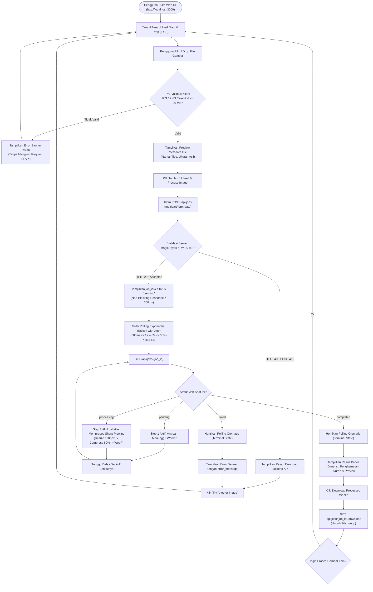
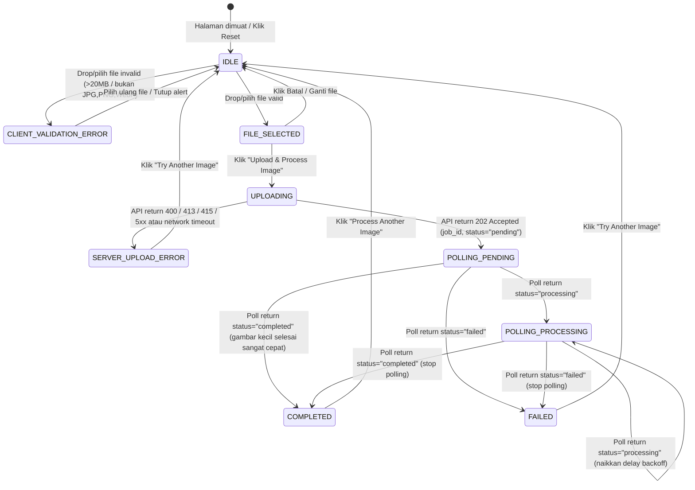

# USER FLOW SPECIFICATION (USER_FLOW.md)

## CFactory Async Image Processor (CAIP)
### Peta Perjalanan Pengguna, Skenario Interaksi, dan State Machine Antarmuka

| Metadata Dokumen | Nilai |
|------------------|-------|
| **Versi** | 1.0 |
| **Tanggal Terbit** | 2026-11-21 |
| **Sistem** | CFactory Async Image Processor (CAIP) |
| **Teknologi UI** | Next.js (App Router) + React 19 + TypeScript Strict + Tailwind CSS |
| **Status Dokumen** | Approved |

---

## 1. Peta Perjalanan Pengguna End-to-End (Overall User Journey)

Diagram berikut memetakan alur perjalanan lengkap pengguna sejak membuka antarmuka web di `http://localhost:3000` hingga mendapatkan file gambar `.webp` yang telah dioptimasi atau menerima pesan kegagalan yang informatif.

---

## 2. Rincian Alur Pengguna per Skenario (Detailed User Flows)

### 2.1 `UF-01`: Alur Unggah Gambar Valid & Delegasi Asinkron
**Aktor**: End User / Technical Evaluator  
**Prasyarat**: Layanan `frontend` (`:3000`), `backend-api` (`:4000`), `Redis`, dan `NeonDB` dalam kondisi sehat.  
**Aturan Bisnis Terkait**: `BR-01`, `BR-02`, `BR-03`, `BR-06`

| Langkah | Aksi Pengguna | Respons Antarmuka (Next.js) | Aktivitas Backend (`backend-api`) |
|---|---|---|---|
| **1** | Membuka `http://localhost:3000`. | Merender zona *drag-and-drop* dengan informasi format (`JPG`, `PNG`, `WebP`) dan batas maksimum (`20 MB`). | Tidak ada request upload; dapat melakukan *health indicator check* opsional ke `GET /api/health`. |
| **2** | Menyeret gambar berukuran besar (misal `14.5 MB` PNG `4000x3000`) ke *dropzone* atau memilih melalui file explorer. | Menjalankan pengecekan tipe MIME (`image/jpeg`, `image/png`, `image/webp`) dan ukuran (`0 < size <= 20,971,520 bytes`), lalu menampilkan kartu pratinjau file beserta tombol `"Upload & Process Image"`. | Belum ada panggilan ke backend. |
| **3** | Menekan tombol `"Upload & Process Image"`. | Mengubah tombol menjadi state loading (`"Uploading..."`), menonaktifkan unggahan ganda, dan mengirimkan `FormData` dengan key `image` ke `POST /api/jobs`. | Menerima stream multipart, memeriksa batas 20 MB dan *magic bytes*, menulis file mentah ke `storage/uploads/{job_id}.png`, melakukan `INSERT` ke tabel `image_jobs` (`status='pending'`), dan memasukkan job ke BullMQ queue. |
| **4** | Menunggu respons server (`< 200ms`). | Menerima JSON `202 Accepted`, menyimpan `job_id`, langsung merender `JobStatusCard` dengan `job_id` yang bisa disalin (*copyable*) dan badge `pending`. | Mengembalikan HTTP `202 Accepted` seketika tanpa menunggu worker Sharp selesai memproses gambar. |

---

### 2.2 `UF-02`: Alur Pemantauan Status Real-Time dengan Exponential Backoff Polling
**Aktor**: End User (otomatis melalui `useJobPolling` hook)  
**Prasyarat**: `UF-01` berhasil dan `job_id` aktif berada di state non-terminal (`pending` atau `processing`).  
**Aturan Bisnis Terkait**: `BR-04`, `BR-10`

| Langkah | Tahap Siklus Polling | Perilaku Hook `useJobPolling` | Tampilan UI yang Diperbarui |
|---|---|---|---|
| **1** | Poll Pertama (`t = 500ms ±15%`) | Setelah `202 Accepted`, menjadwalkan timeout pertama (~`500ms`) dengan `AbortController` dan memanggil `GET /api/jobs/{job_id}`. | Menampilkan telemetri status polling: `"Checking status... (next check in ~0.5s)"`. |
| **2** | Worker Mulai Eksekusi | Saat API mengembalikan `status: "processing"`, hook memperbarui state UI dan menaikkan jadwal interval backoff berikutnya menjadi `1000ms ±15%`. | Stepper berpindah dari **Step 1 (Pending)** ke **Step 2 (Processing)** dengan animasi pulse biru serta menandakan background worker sedang menjalankan Resize -> Compress -> WebP. |
| **3** | Pemrosesan Gambar Besar Berjalan | Jika gambar berukuran hingga 20 MB masih diproses, interval polling meningkat bertahap: `2000ms` -> `3500ms` -> `5000ms` (cap maksimum) dengan random jitter `±15%`. | UI tetap menampilkan status `processing`, `job_id`, dan waktu berlalu (*elapsed timer*) secara responsif tanpa membekukan tab browser. |
| **4** | Mencapai State Terminal | Begitu API mengembalikan `status: "completed"` atau `status: "failed"`, hook **segera membatalkan timer & `AbortController`** dan menghentikan seluruh request polling berikutnya. | Indikator polling aktif berhenti; UI berpindah ke panel hasil (`UF-03`) atau panel error (`UF-05`). |
| **5** | Penutupan Tab / Navigasi (*Unmount*) | Hook menjalankan *cleanup function* `useEffect` untuk memanggil `clearTimeout` dan `abortController.abort()`. | Zero *memory leak* dan zero *orphan HTTP polling request*. |

---

### 2.3 `UF-03`: Alur Peninjauan Metrik Hasil & Unduhan Gambar WebP
**Aktor**: End User  
**Prasyarat**: Worker selesai mengeksekusi pipeline (`Resize <= 1280px longest side` -> `Compress 80%` -> `Convert WebP`), status job menjadi `completed`.  
**Aturan Bisnis Terkait**: `BR-05`, `BR-07`, `BR-08`

1. **Transisi UI Otomatis**: Begitu `GET /api/jobs/{job_id}` mengembalikan `status: "completed"`, *Lifecycle Stepper* menandai **Step 3 (Completed)** berwarna hijau emerald.
2. **Penampilan `ResultPanel`**:
   - Menampilkan ukuran file asli (`original_size_bytes`) vs ukuran file hasil (`processed_size_bytes`), contoh: `14.50 MB -> 182.4 KB (98.7% lebih ringan)`.
   - Menampilkan dimensi akhir hasil resize (`{width} × {height} px`), memastikan sisi terpanjang tidak melebihi `1280px` dan rasio aspek asli terjaga.
   - Menampilkan pratinjau visual gambar `.webp` yang sudah diproses.
3. **Aksi Unduh Gambar**:
   - Pengguna mengklik tombol **"Download Processed WebP"**.
   - Browser memanggil `GET /api/jobs/{job_id}/download`.
   - Backend memverifikasi `status === 'completed'` dan keberadaan file di `storage/processed/{job_id}.webp`, lalu mengirimkan binary stream dengan header `Content-Type: image/webp` dan `Content-Disposition: attachment; filename="processed-{base_name}.webp"`.
   - Browser otomatis menyimpan file `.webp` ke folder unduhan perangkat pengguna.
4. **Pemrosesan Gambar Baru**: Pengguna dapat menekan tombol **"Process Another Image"** untuk membersihkan state job saat ini dan kembali ke `IDLE`.

---

### 2.4 `UF-04`: Alur Penanganan Kegagalan Validasi Input (Klien & Server)
**Aktor**: End User  
**Prasyarat**: Pengguna mencoba mengunggah file yang melanggar aturan format (`BR-01`) atau ukuran (`BR-02`).

| Skenario Pelanggaran | Jalur Penangkapan Pertama (Frontend) | Jalur Pertahanan Otoritatif (Backend API) | Tampilan UI untuk Pengguna |
|---|---|---|---|
| **Ukuran File > 20 MB** (misal `25.4 MB`) | `ImageDropzone` mendeteksi `file.size > 20971520` secara instan dan memblokir tombol upload. | Jika request dikirim langsung via cURL/API melebihi 20 MB, Hono mengembalikan `HTTP 413 Payload Too Large` (`FILE_TOO_LARGE`). | Error Alert Banner berwarna merah: `"Ukuran file (25.4 MB) melebihi batas maksimum 20 MB."` |
| **Ekstensi / MIME Bukan Gambar** (misal `dokumen.pdf`, `.exe`, `.gif`) | `ImageDropzone` menolak file yang bukan `image/jpeg`, `image/png`, atau `image/webp`. | Backend menolak dengan `HTTP 415 Unsupported Media Type` (`UNSUPPORTED_MEDIA_TYPE`). | Error Alert Banner: `"Format file tidak didukung. Harap unggah gambar JPG, PNG, atau WebP."` |
| **File Spoofing** (file `.txt` diubah namanya menjadi `.jpg`) | Dapat lolos pengecekan ekstensi klien sementara. | Backend membaca **magic bytes** header file (`FF D8 FF` untuk JPEG, `89 50 4E 47` untuk PNG, `RIFF....WEBP` untuk WebP) dan menolak dengan `HTTP 415`. | Error Alert Banner menampilkan `error.message` resmi dari API bahwa konten file tidak sesuai dengan signature gambar valid. |
| **File Kosong (`0 bytes`)** | Ditolak di pre-validasi klien (`file.size === 0`). | Ditolak Backend dengan `HTTP 400 Bad Request` (`EMPTY_FILE`). | Error Alert Banner: `"File gambar kosong (0 bytes) tidak dapat diproses."` |

---

### 2.5 `UF-05`: Alur Penanganan Kegagalan Pemrosesan Background Worker
**Aktor**: End User  
**Prasyarat**: File lolos upload (`202 Accepted`), namun worker gagal memprosesnya (misal stream biner gambar rusak/korup di tengah file, atau melewati batas maksimum retry akibat error sistem).  
**Aturan Bisnis Terkait**: `BR-04`, `BR-08`, `BR-10`

1. **Deteksi Kegagalan di Worker**: Sharp gagal mendekode gambar korup dan melempar exception. Worker membersihkan file `.tmp.webp` jika ada dan memperbarui tabel `image_jobs` di NeonDB PostgreSQL menjadi `status = 'failed'` beserta `error_message` yang jelas dan `completed_at = NOW()`.
2. **Pembaruan Status via Polling**: Pada siklus poll berikutnya, `GET /api/jobs/{job_id}` mengembalikan `status: "failed"` dan field `error_message`.
3. **Penghentian Polling & Tampilan Error**:
   - `useJobPolling` langsung menghentikan timer polling.
   - `JobStatusCard` mengubah badge status menjadi merah (`FAILED`) dan menandai langkah pemrosesan sebagai gagal.
   - `ErrorBanner` menampilkan penjelasan informatif dari `error_message` (misal: *"Image processing failed: input file is corrupted or contains an invalid image stream."*).
4. **Pemulihan Aksi Pengguna**: UI menyediakan tombol **"Try Another Image"** yang mereset state ke `IDLE` agar pengguna bisa segera mengunggah gambar pengganti.

---

## 3. Diagram State Machine Antarmuka (Frontend UI State Machine)

---

## 4. Matriks Pemetaan User Flow ke Business Rules & API Endpoints

| Kode User Flow | Nama Alur | Business Rules yang Ditegakkan | Komponen UI Terlibat | Endpoint API & Queue Terlibat |
|---|---|---|---|---|
| **UF-01** | Unggah Gambar Valid & Delegasi Asinkron | `BR-01`, `BR-02`, `BR-03`, `BR-06` | `ImageDropzone`, `FilePreviewCard` | `POST /api/jobs` -> NeonDB `INSERT` -> BullMQ `Queue.add()` |
| **UF-02** | Polling Status Exponential Backoff | `BR-04`, `BR-10` | `JobStatusCard`, `PollingTelemetry` | `GET /api/jobs/:jobId` (interval `500ms` -> `5000ms` + jitter) |
| **UF-03** | Peninjauan Hasil & Unduh WebP | `BR-05`, `BR-07`, `BR-08` | `ResultPanel` | `GET /api/jobs/:jobId/download` (binary stream `image/webp`) |
| **UF-04** | Kegagalan Validasi Input | `BR-01`, `BR-02` | `ImageDropzone`, `ErrorBanner` | `POST /api/jobs` (`400` / `413` / `415`) |
| **UF-05** | Kegagalan Proses Worker & Reset | `BR-04`, `BR-08`, `BR-10` | `JobStatusCard`, `ErrorBanner` | `GET /api/jobs/:jobId` (`status: "failed"`, `error_message`) |
