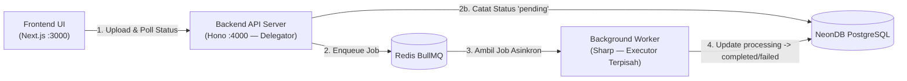

# BUKU PANDUAN PENGGUNA & PENGUJIAN (USER GUIDEBOOK)

## CFactory Async Image Processor (CAIP)
### Panduan Operasional Aplikasi Pengolahan Gambar Asinkron & Lembar Uji Coba End-to-End

> Dokumen ini merupakan panduan resmi untuk **Pengguna Akhir** dan **Technical Evaluator (CFactory)** dalam menjalankan, mengoperasikan antarmuka web, menguji REST API secara langsung, serta memverifikasi seluruh skenario fungsional maupun ketahanan sistem (*crash recovery* & *exponential backoff*).

---

## 📑 DAFTAR ISI

1. [Pengenalan Aplikasi & Ikhtisar Sistem](#1-pengenalan-aplikasi--ikhtisar-sistem)
   - [1.1 Gambaran Umum Sistem](#11-gambaran-umum-sistem)
   - [1.2 Spesifikasi Transformasi Gambar](#12-spesifikasi-transformasi-gambar)
   - [1.3 Pemisahan Peran Server vs Worker](#13-pemisahan-peran-server-vs-worker)
2. [Panduan Menjalankan & Mengakses Aplikasi](#2-panduan-menjalankan--mengakses-aplikasi)
   - [2.1 Menjalankan Full-Stack dengan 1 Perintah (Docker Compose)](#21-menjalankan-full-stack-dengan-1-perintah-docker-compose)
   - [2.2 Menjalankan secara Lokal untuk Development](#22-menjalankan-secara-lokal-untuk-development)
   - [2.3 Verifikasi Kesehatan Layanan](#23-verifikasi-kesehatan-layanan)
3. [Panduan Operasional Antarmuka Web (Next.js Frontend)](#3-panduan-operasional-antarmuka-web-nextjs-frontend)
   - [3.1 Mengunggah Gambar (Drag-and-Drop & File Picker)](#31-mengunggah-gambar-drag-and-drop--file-picker)
   - [3.2 Memahami Validasi Format & Batas Ukuran 20 MB](#32-memahami-validasi-format--batas-ukuran-20-mb)
   - [3.3 Melacak job_id & Tahapan Progres Asinkron](#33-melacak-job_id--tahapan-progres-asinkron)
   - [3.4 Mengunduh Hasil Gambar WebP & Membaca Metrik Penghematan](#34-mengunduh-hasil-gambar-webp--membaca-metrik-penghematan)
   - [3.5 Menangani Kondisi Error & Mengunggah Gambar Baru](#35-menangani-kondisi-error--mengunggah-gambar-baru)
4. [Panduan Pengujian REST API Langsung via cURL](#4-panduan-pengujian-rest-api-langsung-via-curl)
5. [Lembar Checklist Skenario Uji Coba End-to-End](#5-lembar-checklist-skenario-uji-coba-end-to-end)
6. [Pusat Bantuan & Penanganan Masalah (Troubleshooting & FAQ)](#6-pusat-bantuan--penanganan-masalah-troubleshooting--faq)

---

## 1. PENGENALAN APLIKASI & IKHTISAR SISTEM

### 1.1 Gambaran Umum Sistem
**CFactory Async Image Processor (CAIP)** adalah aplikasi web untuk mengoptimalkan gambar beresolusi tinggi (hingga ukuran **20 MB**) menjadi gambar format **WebP** yang ringan dan siap pakai di web, dengan menerapkan arsitektur pemrosesan asinkron berbasis antrean (*Queue-Based Async Worker*).

Alih-alih memproses gambar langsung di dalam thread HTTP server saat pengguna mengunggah file, sistem ini:
1. Menerima unggahan secara cepat dan langsung mengembalikan pengenal unik **`job_id`**.
2. Mendelegasikan pekerjaan berat pemrosesan gambar ke **Background Worker** terpisah melalui **Redis BullMQ**.
3. Mencatat siklus status secara transparan di **NeonDB PostgreSQL** (`pending` -> `processing` -> `completed` / `failed`).
4. Memberi tahu antarmuka pengguna menggunakan strategi polling cerdas (**Exponential Backoff with Jitter**) begitu hasil siap diunduh.

### 1.2 Spesifikasi Transformasi Gambar
Setiap gambar yang diunggah dan valid akan diproses oleh Background Worker (**Sharp / libvips**) dengan urutan operasi baku berikut:
1. **Format Input yang Diizinkan**: `JPG/JPEG`, `PNG`, atau `WebP` dengan ukuran `> 0 bytes` dan maksimal `20 MB` (`20,971,520 bytes`).
2. **Tahap 1 — Resize**: Menyesuaikan ukuran sehingga sisi terpanjang (*longest side*, baik lebar maupun tinggi) maksimal **`1280px`**, dengan tetap mempertahankan **aspect ratio** asli dan **tanpa memperbesar gambar kecil** (*without enlargement*). Orientasi EXIF kamera juga dinormalisasi otomatis.
3. **Tahap 2 — Compress**: Mengompresi gambar ke kualitas **`80%`**.
4. **Tahap 3 — Convert**: Mengonversi format keluaran menjadi **WebP** (`.webp`).

### 1.3 Pemisahan Peran Server vs Worker



* **Backend API (`backend-api`)** **tidak pernah** melakukan manipulasi gambar (`sharp` dilarang berada di modul API).
* **Background Worker (`worker`)** berjalan sebagai proses OS / kontainer terpisah khusus mengeksekusi tugas CPU-intensive tersebut.

---

## 2. PANDUAN MENJALANKAN & MENGAKSES APLIKASI

### 2.1 Menjalankan Full-Stack dengan 1 Perintah (Docker Compose)
Metode ini direkomendasikan untuk penilai teknis agar seluruh stack (`frontend`, `backend-api`, `worker`, `redis`) berjalan serentak tanpa instalasi dependensi manual:

1. Salin file contoh konfigurasi environment:
   ```bash
   cp .env.example .env
   ```
2. Isi `DATABASE_URL` pada file `.env` dengan connection string **NeonDB PostgreSQL** Anda (pastikan skema `/Database/schema.sql` sudah dieksekusi di NeonDB).
3. Jalankan seluruh layanan dengan satu perintah:
   ```bash
   docker compose up --build
   ```
4. Tunggu hingga log menampilkan bahwa Redis sehat, Backend API mendengarkan port `4000`, Worker terhubung ke queue, dan Frontend Next.js siap di port `3000`.
5. Buka browser menuju **`http://localhost:3000`**.

### 2.2 Menjalankan secara Lokal untuk Development
Jika Anda menjalankan layanan secara terpisah di terminal lokal (membutuhkan Node.js 20+ dan Redis aktif):
1. Jalankan Redis secara lokal (atau via `docker compose up redis -d`).
2. Pastikan tabel `image_jobs` sudah tersedia di NeonDB melalui `Database/schema.sql`.
3. Buka 3 terminal terpisah:
   - **Terminal 1 (Backend API)**: `cd backend-api && npm install && npm run dev` (berjalan di `http://localhost:4000`).
   - **Terminal 2 (Background Worker)**: `cd worker && npm install && npm run dev` (berjalan di proses terpisah).
   - **Terminal 3 (Frontend Web UI)**: `cd frontend && npm install && npm run dev` (berjalan di `http://localhost:3000`).

### 2.3 Verifikasi Kesehatan Layanan
Sebelum mengunggah gambar, Anda dapat memastikan koneksi API, NeonDB PostgreSQL, dan Redis aktif dengan membuka:
* URL Browser / cURL: `GET http://localhost:4000/api/health`
* Respons sehat (`200 OK`):
  ```json
  {
    "success": true,
    "status": "ok",
    "services": {
      "database": "up",
      "redis": "up"
    }
  }
  ```

---

## 3. PANDUAN OPERASIONAL ANTARMUKA WEB (NEXT.JS FRONTEND)

### 3.1 Mengunggah Gambar (Drag-and-Drop & File Picker)
1. Buka `http://localhost:3000` pada browser modern (Chrome, Firefox, Edge, atau Safari).
2. Anda akan melihat area **Upload Dropzone**.
3. Pilih gambar dengan salah satu dari dua cara:
   * **Drag & Drop**: Seret file gambar dari File Explorer / Finder lalu lepaskan di dalam kotak dropzone.
   * **Klik File Picker**: Klik area dropzone untuk membuka jendela pemilih file sistem operasi.
4. Setelah file dipilih, kartu pratinjau akan menampilkan **nama file**, **tipe MIME**, dan **ukuran asli**.
5. Klik tombol **"Upload & Process Image"** untuk mengirim gambar ke server.

### 3.2 Memahami Validasi Format & Batas Ukuran 20 MB
Untuk menjaga stabilitas sistem, aplikasi menerapkan **validasi dua lapis** (di browser untuk umpan balik instan, dan di server melalui pengecekan *magic bytes*):
* **Format diterima**: `.jpg`, `.jpeg`, `.png`, `.webp`.
* **Batas ukuran**: Minimal `> 0 bytes` dan maksimal `20 MB` (`20,971,520 bytes`).
* Jika Anda menjatuhkan file selain format tersebut (misal `.pdf`, `.svg`, `.txt`) atau file `> 20 MB`, tombol upload akan dinonaktifkan dan spanduk peringatan akan menjelaskan penyebab penolakan secara langsung.

### 3.3 Melacak `job_id` & Tahapan Progres Asinkron
Seketika setelah upload diterima server (`HTTP 202 Accepted`):
1. Halaman langsung menampilkan kartu pelacakan status berisi **`job_id`** (berformat UUID v4, lengkap dengan tombol **Copy ID**).
2. **Lifecycle Progress Stepper** memperlihatkan status terkini:
   * **`pending`**: File tersimpan, menunggu worker mengambil tugas dari antrean Redis.
   * **`processing`**: Worker sedang mengeksekusi *Resize -> Compress 80% -> Convert WebP*.
   * **`completed`**: Pemrosesan selesai dan hasil `.webp` tersimpan atomik di server.
   * **`failed`**: Pemrosesan gagal; pesan error detail akan ditampilkan.
3. Di bagian bawah kartu status terdapat **Indikator Polling** yang menunjukkan jeda *Exponential Backoff* saat itu (dimulai dari ~`0.5s`, meningkat bertahap hingga batas maksimal `5s` dengan jitter agar tidak membebani server). Begitu status mencapai `completed` atau `failed`, polling berhenti otomatis.

### 3.4 Mengunduh Hasil Gambar WebP & Membaca Metrik Penghematan
Ketika status mencapai **`completed`**:
1. **Result Panel** muncul menampilkan:
   * **Dimensi Output**: Lebar × Tinggi akhir dalam piksel (dipastikan sisi terpanjang `<= 1280px`).
   * **Perbandingan Ukuran**: Ukuran file awal vs ukuran `.webp` hasil, beserta persentase pengurangan ukuran (contoh: `12.40 MB -> 240.5 KB • Hemat 98.1%`).
   * **Pratinjau Hasil**: Pratinjau visual gambar `.webp` hasil optimasi.
2. Klik tombol **"Download Processed WebP"** untuk mengunduh file gambar hasil ke perangkat Anda.

### 3.5 Menangani Kondisi Error & Mengunggah Gambar Baru
Jika terjadi kegagalan validasi di server atau worker gagal memproses gambar (misal file `.jpg` korup):
1. **Error Alert Banner** tampil menonjol lengkap dengan kode/pesan kegagalan yang informatif dari backend/worker.
2. Polling otomatis dihentikan agar tidak mengirim request berulang.
3. Klik tombol **"Try Another Image"** (atau **"Process Another Image"** setelah sukses) untuk mereset tampilan ke kondisi awal dan memulai unggahan baru.

---

## 4. PANDUAN PENGUJIAN REST API LANGSUNG VIA CURL

Bagi *Technical Reviewer* yang ingin menguji endpoint API secara langsung di luar UI browser:

1. **Upload Gambar (`POST /api/jobs`) — Mengembalikan `202 Accepted` Instan**:
   ```bash
   curl -i -X POST http://localhost:4000/api/jobs \
     -F "image=@/path/to/sample-large-photo.jpg"
   ```
   *Contoh respons (`HTTP/1.1 202 Accepted`)*:
   ```json
   {
     "success": true,
     "data": {
       "job_id": "a7e9b5c2-4d3a-4c11-98f0-123456789abc",
       "status": "pending",
       "original_filename": "sample-large-photo.jpg",
       "original_size_bytes": 15728640,
       "created_at": "2026-11-21T06:40:00.000Z"
     }
   }
   ```

2. **Cek Status Job (`GET /api/jobs/:jobId`)**:
   ```bash
   curl -s http://localhost:4000/api/jobs/a7e9b5c2-4d3a-4c11-98f0-123456789abc
   ```
   *Contoh respons saat selesai (`200 OK`)*:
   ```json
   {
     "success": true,
     "data": {
       "job_id": "a7e9b5c2-4d3a-4c11-98f0-123456789abc",
       "status": "completed",
       "original_filename": "sample-large-photo.jpg",
       "original_mime_type": "image/jpeg",
       "original_size_bytes": 15728640,
       "processed_size_bytes": 214590,
       "width": 1280,
       "height": 853,
       "download_url": "/api/jobs/a7e9b5c2-4d3a-4c11-98f0-123456789abc/download",
       "error_message": null,
       "attempts": 1,
       "created_at": "2026-11-21T06:40:00.000Z",
       "started_at": "2026-11-21T06:40:00.045Z",
       "completed_at": "2026-11-21T06:40:01.320Z"
     }
   }
   ```

3. **Unduh Hasil WebP (`GET /api/jobs/:jobId/download`)**:
   ```bash
   curl -L -o result.webp http://localhost:4000/api/jobs/a7e9b5c2-4d3a-4c11-98f0-123456789abc/download
   ```

---

## 5. LEMBAR CHECKLIST SKENARIO UJI COBA END-TO-END

Gunakan lembar checklist berikut untuk memverifikasi kelayakan sistem secara keseluruhan:

### Skenario 1: Verifikasi Startup & Healthcheck
- [ ] Perintah `docker compose up --build` (atau startup 3 layanan lokal) berjalan tanpa error.
- [ ] Endpoint `GET http://localhost:4000/api/health` mengembalikan `status: "ok"`, `database: "up"`, dan `redis: "up"`.
- [ ] Halaman `http://localhost:3000` terbuka sempurna tanpa error console browser atau error CORS.

### Skenario 2: Non-Blocking Upload Gambar Besar (Landscape > 1280px)
- [ ] Unggah foto `.jpg` atau `.png` beresolusi besar (misal `4000x2667 px`, ukuran `10–19 MB`).
- [ ] `POST /api/jobs` selesai dan mengembalikan `202 Accepted` berisi `job_id` dalam hitungan milidetik (`< 500ms`), jauh sebelum pemrosesan Sharp selesai.
- [ ] UI langsung menampilkan `job_id` dan status bertransisi `pending` -> `processing` -> `completed`.
- [ ] Hasil unduhan berformat `.webp` (header file valid WebP) dengan lebar `1280px` dan tinggi proporsional `853px`.

### Skenario 3: Verifikasi Aspect Ratio Portrait & Tanpa Upscaling
- [ ] Unggah foto **portrait** (`2000x4000 px`) -> Hasil memiliki **tinggi `1280px`** dan **lebar `640px`** (longest side = `1280px`).
- [ ] Unggah foto **kecil** (`800x600 px`) -> Hasil tetap **`800x600 px`** (tidak diperbesar ke `1280px`), namun terkompresi menjadi `.webp` kualitas 80%.

### Skenario 4: Penolakan Batas Ukuran (> 20 MB) & Format Tidak Valid
- [ ] Pilih file `> 20 MB` di UI -> Validasi klien langsung menolak dan menampilkan pesan batas 20 MB.
- [ ] Kirim file `.pdf` atau `.txt` yang di-rename menjadi `.jpg` via `curl` ke `POST /api/jobs` -> Backend menolak dengan `HTTP 415` karena validasi *magic bytes*.

### Skenario 5: Validasi Endpoint Download Sebelum Selesai
- [ ] Panggil `GET /api/jobs/:jobId/download` ketika job masih berstatus `pending` atau `processing` -> API mengembalikan `HTTP 409 Conflict` beserta pesan informatif.

### Skenario 6: Kegagalan Gambar Korup & Pesan Error Informatif
- [ ] Unggah file gambar korup (header JPEG/PNG valid di 16 byte pertama, lalu diisi byte acak) -> Job masuk `pending` -> `processing` -> **`failed`**.
- [ ] UI menghentikan polling dan menampilkan `error_message` yang jelas pada `ErrorBanner`.

### Skenario 7: Efisiensi Exponential Backoff Polling (DevTools Network Check)
- [ ] Buka tab **Network** di Browser DevTools saat mengunggah gambar besar.
- [ ] Verifikasi jeda antar request `GET /api/jobs/:jobId` meningkat secara bertahap (`~0.5s`, `~1s`, `~2s`, `~3.5s`, `~5s`) dan **berhenti total** (0 request tambahan) sesaat setelah status menjadi `completed` atau `failed`.

### Skenario 8: Ketahanan Worker Crash & Graceful Shutdown
- [ ] Unggah beberapa gambar besar lalu hentikan kontainer worker (`docker compose stop worker`) di tengah pemrosesan.
- [ ] Worker menyelesaikan job aktif atau BullMQ mendeteksi *stalled job* saat worker dinyalakan ulang (`docker compose start worker`) hingga job kembali terselesaikan tanpa menghasilkan file `.webp` yang korup.

---

## 6. PUSAT BANTUAN & PENANGANAN MASALAH (TROUBLESHOOTING & FAQ)

### ❓ Mengapa muncul error `"Database connection failed"` pada `/api/health`?
* **Penyebab**: `DATABASE_URL` pada `.env` belum diisi dengan URL NeonDB PostgreSQL yang valid, atau parameter `?sslmode=require` belum disertakan, atau skrip `Database/schema.sql` belum dijalankan.
* **Solusi**: Periksa kembali nilai `DATABASE_URL` di `.env`, pastikan instance NeonDB aktif, dan jalankan `Database/schema.sql` melalui Neon SQL Editor atau `psql`.

### ❓ Mengapa status job tertahan cukup lama di `pending`?
* **Penyebab**: Proses `worker` belum dijalankan atau koneksi `REDIS_URL` antara `backend-api` dan `worker` mengarah ke instance Redis yang berbeda.
* **Solusi**: Pastikan service `worker` berjalan (`docker compose ps` atau cek terminal worker) dan pastikan kedua layanan menggunakan nilai `REDIS_URL` dan `BULLMQ_QUEUE_NAME` yang sama persis.

### ❓ Mengapa endpoint download mengembalikan `404` padahal status di NeonDB `completed`?
* **Penyebab**: `backend-api` dan `worker` tidak berbagi direktori penyimpanan yang sama (nilai `STORAGE_DIR` berbeda atau Docker volume tidak ter-mount ke kedua kontainer).
* **Solusi**: Pastikan `docker-compose.yml` me-mount named volume/bind mount yang sama ke `/app/storage` di kontainer `backend-api` maupun `worker`, serta variabel `STORAGE_DIR` konsisten.

### ❓ Mengapa Browser memblokir request ke `http://localhost:4000` dengan error CORS?
* **Penyebab**: Variabel `CORS_ORIGIN` pada `backend-api` tidak sesuai dengan origin tempat Next.js diakses (misal Anda mengakses lewat `http://127.0.0.1:3000` sementara `CORS_ORIGIN` diset `http://localhost:3000`).
* **Solusi**: Sesuaikan `CORS_ORIGIN` di `.env` agar cocok dengan alamat akses browser, lalu restart `backend-api`.
